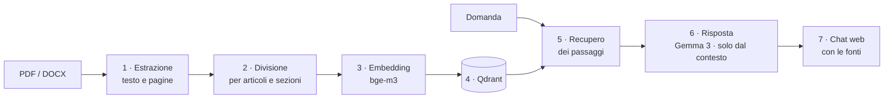

# Clio – assistente che risponde sui documenti e cita sempre le fonti

Fai una domanda in linguaggio naturale, Clio cerca le parti pertinenti dei documenti e risponde **solo sulla base di quelle**, indicando da dove viene ogni informazione: *[GDPR, art. 33]*. Se la risposta nei documenti non c'è, lo dice: **"Non trovo questa informazione nei documenti."** Non inventa.

Tutto gira **in locale**, con modelli open source: i documenti non lasciano mai la macchina.

La Knowledge Base dimostrativa contiene tre testi europei su protezione dei dati, sicurezza informatica e intelligenza artificiale: **GDPR**, **NIS2** e **AI Act**.

*Clio is a local retrieval-augmented generation (RAG) pipeline: it answers questions only from your documents, always cites article and page, and explicitly refuses when the answer is not there. Demo knowledge base: GDPR, NIS2 and the EU AI Act (Italian texts).*

---

## Come funziona: 7 passi, uno per responsabilità



| Passo | Cosa fa |
|---|---|
| 1 · Estrazione | testo da PDF e DOCX, con il numero di pagina conservato |
| 2 · Divisione | un pezzo per articolo, allegato o gruppo di considerando; i titoli e il percorso (Capo › Sezione) diventano metadati; intestazioni e note della Gazzetta ufficiale vengono tolte |
| 3 · Embedding | vettori con `bge-m3` via Ollama, con controllo della dimensione |
| 4 · Archivio | una collezione Qdrant per ogni Knowledge Base, ricreata da zero a ogni caricamento |
| 5 · Recupero | i passaggi più vicini alla domanda, e la misura della qualità sul Golden Set |
| 6 · Risposta | il modello riceve solo i passaggi recuperati, numerati, e deve citarli |
| 7 · Chat web | interfaccia con accesso protetto e fonti in evidenza, con le pagine |

Ogni passo produce un **report leggibile** e un **log** con nome della Knowledge Base e orario, così ogni esecuzione si può ricostruire e confrontare con le altre.

## Perché ci si può fidare delle risposte

- **Le fonti non le scrive il modello.** Sotto ogni risposta Clio aggiunge l'elenco delle fonti costruito dai metadati dei passaggi recuperati (documento, articolo, pagine). Le citazioni scritte dal modello nel testo vengono confrontate con quelle reali, e ogni discrepanza viene segnalata.
- **Se non trova nulla, non chiama il modello.** Senza passaggi recuperati la risposta è fissa e deterministica.
- **Il rifiuto si misura.** Oltre al Golden Set (domande con risposta nota) c'è un **Negative Set**: domande fuori dominio, alcune volutamente vicine al tema, per cui l'unica risposta corretta è "non lo so".
- **Il testo che diventa vettore è pulito.** Numeri di pagina, intestazioni e note a piè di pagina non entrano nell'embedding: restano metadati.
- **Nessuna modifica senza misura.** Parser, divisione, modello e prompt si cambiano solo dopo aver rifatto Golden Set, Negative Set e verifica di determinismo.

## Divisione dei testi normativi

I testi della Gazzetta ufficiale dell'Unione europea non sono semplici da dividere bene. Il profilo `legislativo_ue` riconosce:

- considerando, articoli, allegati, capi e sezioni, controllando che la numerazione sia coerente
- i titoli degli articoli, anche quando vanno a capo
- le intestazioni della Gazzetta nei due formati (fino al 2023 e dal 2023) e le note a piè di pagina, che vengono tolte
- gli articoli troppo lunghi, che vengono divisi per paragrafo, punto o lettera ripetendo l'intestazione in ogni parte

Sui tre testi della demo i conteggi tornano esatti:

| Atto | Considerando | Articoli | Allegati | Pezzi |
|---|---|---|---|---|
| GDPR – Reg. (UE) 2016/679 | 173 | 99 | – | 143 |
| NIS2 – Dir. (UE) 2022/2555 | 144 | 46 | 3 | 88 |
| AI Act – Reg. (UE) 2024/1689 | 180 | 113 | 13 | 200 |

Per documenti aziendali (procedure, policy, manuali) c'è il profilo `sezioni_numerate`, che divide per titoli numerati come "3.1 Gestione degli accessi".

## Validazione

**Demo.** `kb/demo/golden_set.csv` contiene 17 domande con documento e articolo attesi e una risposta di riferimento. `kb/demo/negative_set.csv` contiene 5 domande fuori dominio, per esempio sulle norme ISO o sul Cyber Resilience Act, che *non* sono nel corpus. Il passo 5 misura in che posizione arriva il passaggio giusto (OK / PARZIALE / FALLITO). Il passo 6 produce un CSV per la revisione umana e conta i rifiuti corretti.

**Progetto originale.** Clio nasce da un assistente che ho sviluppato su 62 documenti di un sistema di gestione aziendale (sicurezza delle informazioni, privacy, qualità), che non sono pubblicati. Lì:

- il modello è stato scelto con un **benchmark su 7 modelli** open source
- il recupero ha raggiunto il **90% di risposte giuste al primo posto** sulla Knowledge Base di prova
- sulla Knowledge Base completa: **15 domande, 10 OK, 5 parziali spiegate, 0 fallite**
- **nessuna risposta inventata** sulle domande fuori dominio
- l'interfaccia è stata provata da un gruppo di colleghi

**Una cosa imparata lì:** il punteggio di somiglianza non basta a riconoscere le domande fuori dominio, perché i punteggi delle domande valide e di quelle fuori tema si sovrappongono. I rifiuti corretti li ottiene l'istruzione data al modello, non una soglia. Per questo la soglia `CLIO_MIN_SCORE` esiste ma è spenta di default.

## Avvio in locale

Servono Python 3.10+ e Docker.

```bash
python -m venv .venv && . .venv/bin/activate
pip install -r requirements.txt

docker compose up -d                                  # Qdrant e Ollama, solo su 127.0.0.1
docker compose exec ollama ollama pull bge-m3
docker compose exec ollama ollama pull gemma3:4b

python -m clio.cli tutto --kb demo                    # passi 1-4
python -m clio.cli retrieval --kb demo --top-k 5      # passo 5 sul Golden Set
python -m clio.cli risposta --kb demo --set entrambi  # passo 6 su Golden e Negative Set

python -m clio.cli utente <nome>                      # crea un utente per la chat
python -m clio.cli web --kb demo                      # http://127.0.0.1:8080
```

Configurazione con variabili d'ambiente: `OLLAMA_URL`, `QDRANT_URL`, `CLIO_EMBED_MODEL`, `CLIO_LLM_MODEL`, `CLIO_MIN_SCORE`, `CLIO_UTENTI_FILE`.

**Una nuova Knowledge Base** è una cartella `kb/<nome>/` con i documenti in `corpus/` e un `kb.json` che indica il profilo di divisione. Il codice non cambia.

## Sicurezza

- Servizi e chat ascoltano solo su `127.0.0.1`; per l'uso in rete va messo davanti un proxy HTTPS
- Accesso alla chat con password salvate come hash PBKDF2, in un file fuori dal repository
- Nessun dato inviato a servizi esterni: modelli e database sono locali
- Registro delle sessioni minimo e documentato

## Test

**123 test automatici**, che non toccano la rete (un controllo nei test la blocca): estrazione da PDF e DOCX veri generati nei test, divisione per articoli con testo nello stile di EUR-Lex (note, intestazioni, articoli a cavallo di pagina), client Ollama e Qdrant simulati, valutazione, risposta e rifiuto, autenticazione della chat, flusso completo da riga di comando.

```bash
python -m pytest -q
```

## Struttura

```
clio/
  parser.py  chunking.py  embedding.py  qdrant.py  retrieval.py  risposta.py  web.py
  profili/   legislativo_ue.py  sezioni_numerate.py
  cli.py  config.py  clienti.py  autenticazione.py  sessioni.py
kb/demo/     corpus/ (PDF), kb.json, golden_set.csv, negative_set.csv, NOTE.txt
tests/
compose.yaml
```

## Fonti dei documenti della demo

Testi ufficiali in lingua italiana da [EUR-Lex](https://eur-lex.europa.eu), © Unione europea. Il riutilizzo è consentito con indicazione della fonte (decisione 2011/833/UE). Fanno fede solo i testi pubblicati nella Gazzetta ufficiale dell'Unione europea.

---

Progettato e sviluppato da **Daniela P Colmenares** · [danielacolmenares.it](https://www.danielacolmenares.it)
